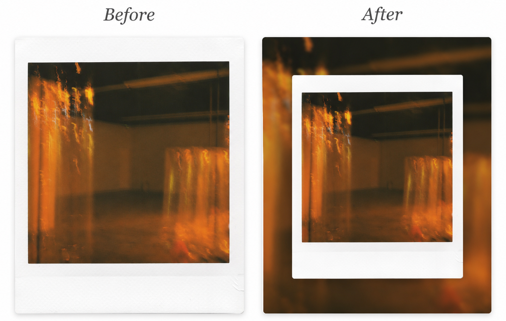

# InstaxEditor

A simple web-based editor for scanned Instax photographs, featuring customizable backgrounds and aspect ratios.

인스탁스 스캔 사진을 간편하게 편집하고, 다양한 배경과 비율로 꾸밀 수 있는 웹 기반 사진 편집기입니다.

**Languages**: 한국어 · English (KO / EN)

## Try It Online

[Open InstaxEditor](https://ymuziq.github.io/InstaxEditor/)

Click the link above to use InstaxEditor directly in your browser. On your smartphone, you can also add it to your **Home Screen** and use it like an app.

별도의 설치 없이 위 링크를 클릭하면 바로 사용할 수 있습니다. 스마트폰에서는 브라우저의 **'홈 화면에 추가'** 기능을 이용해 일반 앱처럼 실행할 수도 있습니다.

## Features

- **Automatic Photo Detection** — Automatically detects the photo area within a scanned Instax frame.
- **Manual Adjustment** — Fine-tune the detected area by dragging its boundaries.
- **Custom Backgrounds** — Choose between an enlarged, blurred photo background or textured backgrounds.
- **Texture Options** — Concrete, marble, vintage paper, and dark stone.
- **Photo Adjustments** — Control background zoom, position, brightness, blur, and texture settings.
- **Aspect Ratios** — Supports 4:5, 1:1, 3:4, 2:3, 9:16, 3:2, 16:9, and custom dimensions.
- **JPEG Export** — Save your finished compositions as JPEG images.
- **PWA Support** — Install on your home screen and use offline after the necessary files are cached.

## How to Use

1. Open InstaxEditor in your browser.
2. Upload a scanned Instax photograph.
3. Adjust the detected photo boundaries if needed.
4. Choose a background and customize its appearance.
5. Select an output aspect ratio.
6. Save your edited image as a JPEG.

Image processing is performed locally in your browser without uploading your photos to a server.

## About

InstaxEditor is a personal project designed to make scanned instant photographs easier to share digitally.

